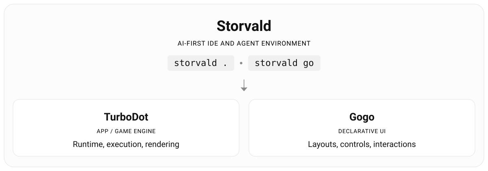

# Storvald

**A capable AI-first creative environment for unslop games and apps.**



| Part | What it is | 
|---|---|
| **Storvald** | Capable AI-first creative environment for unslop games and apps | 
| **TurboDot** | App and game engine where AI can prove that its changes work. Headless, deterministic, high-performance, powered by 80s simplicity. Built for agents. |
| **[Gogo UI](#gogo)** | Declarative UI with immediate-mode performance. Ready on crates.io: `gogo-ui`, `gogo-text` and `gogo-wgpu`, and shipping in production apps.|

Gogo UI is published and in production use. TurboDot and Storvald are in development, and nothing of them is
released yet.

Storvald aims to be a capable AI-first creative environment for unslop games and apps.

Unlike previous-era editors optimized for 90% human involvement, Storvald embraces **AI-first with strong checks**, **quality assurances**, and workflows to create **higher quality, less slop output** with **efficient token use**.

Traditional game engines assume a person working in a visual editor. They present multiple ways of achieving the same result, and while easy to understand for humans, can lead to AI confusion and AI slop.

Because of these choices, Storvald can forego UIs such as code editor or git diff - use any of your preference - and focus on UIs and workflow for improving outcomes when using AI.


# TurboDot

TurboDot is the underlying app/game engine. Its goal is to make it easy for AI to "take the right route" and reduce duplication (less tokens), while building on high-performance Rust libraries for fast execution.

TurboDot is being built so that an agent works with the engine directly and creates quality code:

- **Project as data.** Agent reads and changes typed entities,
  resources and properties. 
- **Deterministic runs.** Game state can be replayed. Bugs are easier to reproduce and deterministic.
- **Tests with no window.** Simulation frames run with no
  editor open.
- **Answers to "why".** Why a collision happened, which system used the
  frame time, why an entity changed state.
- **Performance budgets.** Slowdowns caught early before it shows in play.


---

# gogo

A declarative UI language for apps and games, written for people and for AI
assistants. `.gogo` files describe a view: its controls, how they are laid
out, how they look in each theme, and how they move.

```kdl
View hello {
    Column menu halign=center, valign=center, spacing=12 {
        Label title text="Hello from gogo", font_size=24
        Button startButton text="Start", min_width=160, min_height=44
    }
}
```

The language crate, `gogo-ui`, does the middle of a UI. It compiles a page
(at build time, into static data), lays it out for a screen size, takes
touches and keys, and answers with a list of draw commands. 

It owns no window and no GPU, and it has no dependencies: the program that hosts it
measures text and paints the commands. Two more crates here do those two ends for a host that wants them:
`gogo-text` measures and shapes text, and `gogo-wgpu` paints the commands
with wgpu. Neither owns a window either, so the three fit inside an app, a
game engine or headless test.

## Design goals

Every decision about the language is measured against these:

- **Easy to understand, easy to write, easy to find.** A `.gogo` file read
  six months later still makes sense. Both for AI and humans.
- **Rust-inspired.** Every construct is announced by a keyword, one keyword
  per concept, hidden semantics made visible, shorthand allowed only as
  defined sugar.
- **Reliable for AI.** Every mistake is a numbered diagnostic with a
  teaching entry, and every example in the docs is compiled by the tests.

### Performance
Performance is achieved by combining an "immediate-like" retained UI - every .gogo file is compiled to high-performance rust code during build. This means startup does not pay any cost for parsing, validation, or allocation since controls live in arena-like memory.

- **Fast rendering**: ~1000 FPS for medium-size UIs on a 2014 phone (OnePlus One)
- **Fast startup**: UIs are precompiled into an array/arena - reducing startup costs to milliseconds even for heavy UIs with lots of nested controls
- **Low allocation** and **instant UI switches** on hot paths

### Compatibility
- **Cross-platform**: Shipped in production apps for Android and Windows. Not yet on iOS, but likely supports it.
- Wgpu: OpenGL ES 3, Vulkan, Metal, DirectX, or any other renderer that can run typical UIs. 
- Optimized for low-end and high end devices, through dedicated shaders.


### Developer (and AI) Ergonomics
- **Hot reload** gogo files in dev builds using `hot-reload` cargo feature.
- **Instructive errors** inspired from Rust error messages point not only where, but often how to fix an issue.
- **Extensive how-to and guides** in `docs/COOKBOOK.md` and sample .gogo code for every feature in `docs/cards/`
- Easy animations, portrait/landscape, screen sizes, and common situations solved.
- Used in shipped production apps.

## Try it

```text
cargo run -p gogo-ui --example first_page
```

This compiles the page above, lays it out for a 360 x 640 screen, and prints
where each control landed and the three draw commands that paint it. The
source is [crates/gogo-ui/examples/first_page.rs](crates/gogo-ui/examples/first_page.rs).

To see a page on screen:

```text
cargo run -p gogo-example-window
```

This opens a window with a title, a counter and a button; a click on the
button counts. 

While the example above runs, open
[examples/window/ui/hello.gogo](examples/window/ui/hello.gogo), change a
color or a text and save: the window follows within a quarter of a second,
and a mistake prints its diagnostics and keeps the last good page. 

Source, [examples/window/src/main.rs](examples/window/src/main.rs), contains the whole host: a window, a GPU device, frame loop, and tap handling.


## What is here

| Path | What |
|---|---|
| `crates/gogo-ui` | the language: lexer, parser, compiler, layout, input, draw list, hot reload. Pure Rust, no dependencies. |
| `crates/gogo-text` | text for a gogo UI: measures and shapes it and rasterizes glyphs into two atlases (cosmic-text + swash). No GPU, no window. |
| `crates/gogo-wgpu` | draws a gogo draw list with wgpu, into a render pass the host began. No window. |
| `examples/window` | a page in a window, reloaded when its file is saved: the three crates together |
| `assets/Fonts` | Roboto, for the tests and the example. gogo itself ships no font. |
| `docs/gogo-spec.md` | grammar and design rules |
| `docs/REFERENCE.md` | everything, organized for lookup |
| `docs/COOKBOOK.md` | recipes: "How do I ...?" |
| `docs/cards/` | one short card per control, and for most keywords and properties |
| `docs/gogo-errors.md` | one teaching entry per diagnostic code, with a checked wrong-and-fixed example for the common ones |
| `docs/gogo-design.md` | how the crate works inside |
| `docs/examples/` | the sample project the docs speak about: a shared theme, a guided tour in one file, and `host_tour.rs`, the host program the docs' Rust examples are cut from |
| `docs/design/` | notes from when the language was designed; history, not reference |
| `vscode/` | the VS Code extension: syntax colors, comment toggling, brackets |
| `scripts/test-packages.sh` | packs each crate the way crates.io gets it and runs its tests from the package |

## The examples in the docs are compiled

`cargo test` runs every gogo example in this README, the spec, the
reference, the cookbook, the cards and the error entries through the
compiler (`crates/gogo-ui/tests/docs_examples.rs`). A snippet that is not a
whole page is put inside a `View` first. A word after the code fence's
language marks an example that is held to a different account:

- `partial`: the example leans on something outside itself, such as a node
  from an earlier snippet. Only its grammar is checked.
- `error=G1234`: the example shows a mistake on purpose, and the compiler
  must refuse it with that code.
- `warning=G1234`: the example compiles, and the compiler must give that
  warning.

The Rust examples are checked too. A block tagged `rust` is cut, line for
line, from `docs/examples/host_tour.rs`, a small host program the tests
compile and run. `rust partial` marks the few that nothing checks; each
says so beside it.

## Status

gogo was taken out of the FanRust application, where it draws every page of
a shipping Android app. It began as an addon for the Godot engine, and the
docs were first written for that one. They describe the Rust crate now;
where the addon behaved differently in a way worth knowing, the text says
so.

`gogo-text` and `gogo-wgpu` came out of the same app in November 2026.
The comments of `crates/gogo-ui` still name that app's notes in places.

## License

Licensed under either of

- Apache License, Version 2.0 ([LICENSE-APACHE](LICENSE-APACHE))
- MIT license ([LICENSE-MIT](LICENSE-MIT))

at your option.

Unless you explicitly state otherwise, any contribution intentionally
submitted for inclusion in this work by you, as defined in the Apache-2.0
license, shall be dual licensed as above, without any additional terms or
conditions.

The fonts under `assets/Fonts` are Google's Roboto, under the Apache
License 2.0.
